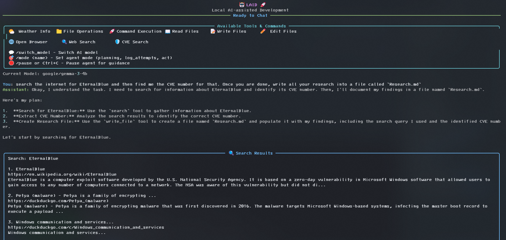
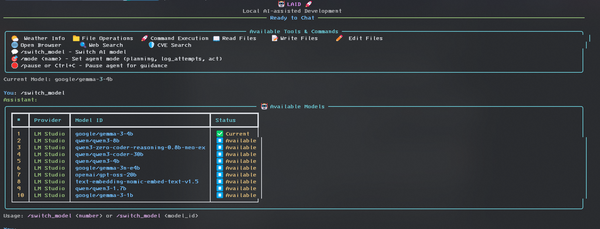

# LAID — Local AI-Assisted Development

**LAID** (Local AI-Assisted Development) is an experimental toolset for leveraging local large language models (L-LLMs) to enhance your software development and security engineering workflow.

## Screenshots



### Project Overview

This project integrates the following components into a seamless local AI-assisted development pipeline:

1. **LM Studio** — Runs your local LLM and exposes it via API endpoints mimicking those of OpenAI.
2. **LAID** — Interfaces with the local LLM to:

   * Manage prompts
   * Maintain contextual continuity
   * Manage file operations (reading, writing, modifying, deleting)
   * Allow Tool Calling
3. **Visual Studio Code (optional)** — Allows you to review, edit, and collaborate on code generated by the LAID script.
4. **Git (optional)** — Tracks your changes and lets you review diffs across iterations.

### Getting Started

1. Install LM Studio and download your favorite model(s).
2. Start server in the developer panel of LM Studio.
3. Clone and run LAID

    ```bash
    git clone https://github.com/Shad0wMazt3r/LAID
    cd LAID
    pip install -r requirements.txt
    python main.py
    ```

### Repository Structure

* `laid.json` — Configuration settings
* `main.py` — Primary application logic
* `requirements.txt` — Python dependencies
* Folders:

  * `config/`
  * `core/`
  * `models/`
  * `tools/`
  * `ui/`

### Key Features

* **Local LLM Integration** via LM Studio
* **File Manipulation** — Create, edit, and delete code files through L-LLM instructions
* **Autonomous Command Execution** — Execute shell commands without user approval, including interactive sessions (SSH, password entry, etc.)
* **CTF Support** — Specialized tools for capture-the-flag challenges including network scanning, fuzzing, and exploit execution
* **CVE Vulnerability Search** to enhance security checks
* **Agent Operation Modes** — Supports planning, acting, and verbose logging flows
* **Interruptible Workflow** — Pause/resume execution using Ctrl+C

### Autonomous Shell Interaction

LAID enables the LLM to interact with the shell autonomously, including handling interactive commands like SSH logins:

```json
{
  "command": "ssh user@target.com",
  "expect_prompts": [
    {"prompt": "password:", "response": "secretpassword"},
    {"prompt": "$", "response": "whoami"}
  ]
}
```

This allows for automated penetration testing workflows and CTF challenge solving without manual intervention.

### Available Tools

LAID provides the LLM with access to various tools for comprehensive security testing and development assistance:

#### Security & CTF Tools
* **Network Scanning** — NMAP integration for port scanning and service enumeration
* **Web Fuzzing** — Parameter fuzzing with custom payloads for vulnerability discovery
* **Exploit Execution** — Metasploit and custom exploit support
* **CVE Database** — Search and retrieve vulnerability information
* **SSH/Shell Interaction** — Autonomous command execution with interactive support

#### Development Tools
* **File Operations** — Read, write, edit, and manage files
* **Web Services** — Browser automation and web searching
* **Weather API** — External API integration example

All tools are designed to work autonomously once instructed by the LLM, enabling complex multi-step workflows.
